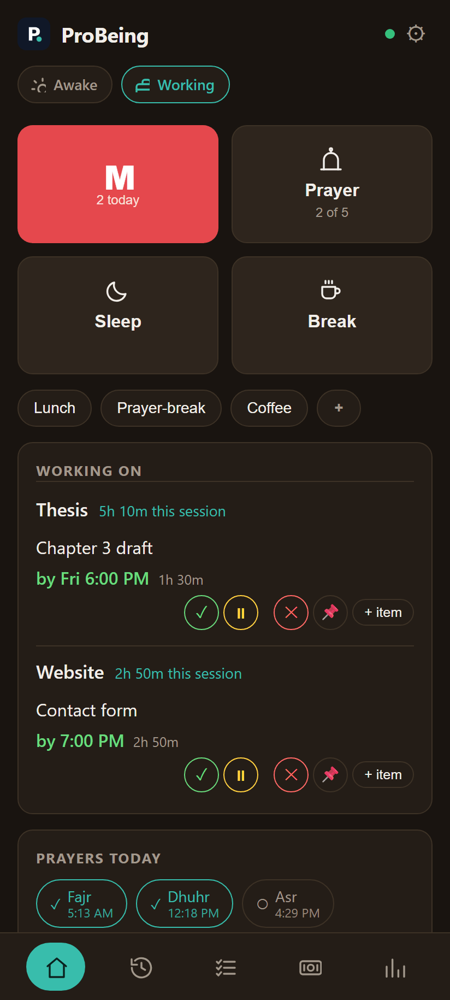
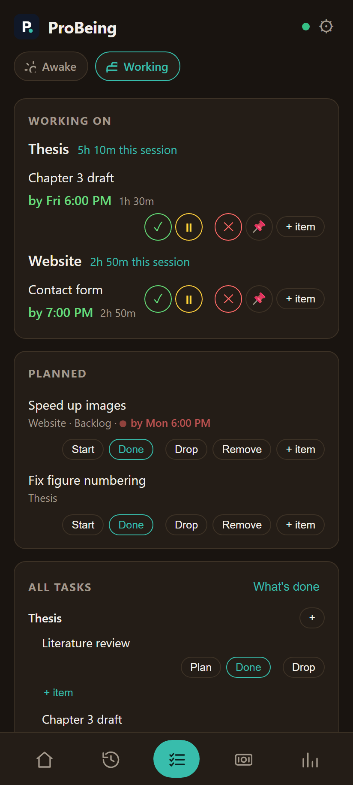
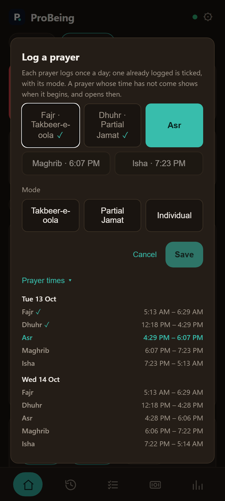
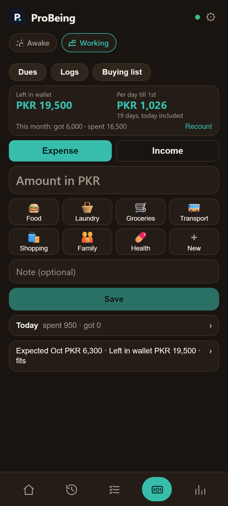
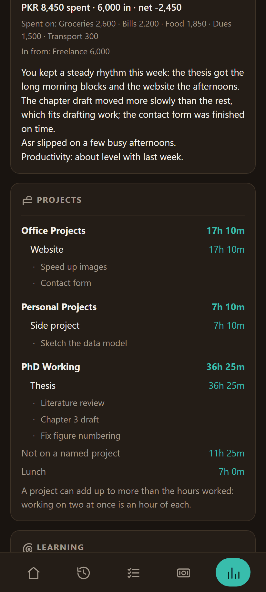
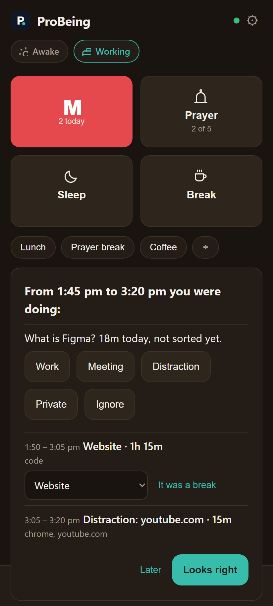
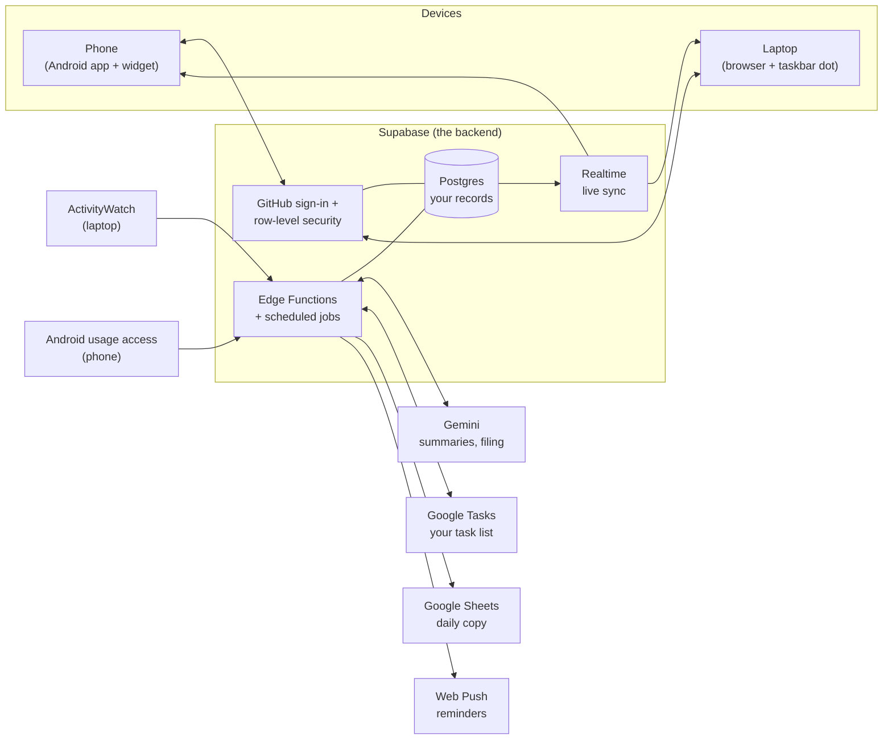

# ProBeing

**A personal day keeper: prayers, work and money logged in one tap, on phone and laptop,
always in sync — with a weekly review written for you.**

ProBeing is a web app you install on your phone and laptop. It keeps a simple record of
your day — when you prayed, what you worked on and for how long, when you took a break,
what you spent — and turns it into a short review at the end of each week.

## What it does

- **Two one-tap buttons.** **Prayer** logs each of the five daily prayers with how you
  prayed it; it opens only once a prayer's time has begun, and shows today's and
  tomorrow's timetable for where you are. **M** is a one-tap counter.
- **"What are you working on?"** Type (or dictate) a line. It is filed automatically
  under the right project and task from your Google Tasks list.
- **Tasks.** *Working on*, *Upcoming* and a *Backlog*, each task with a priority, an
  effort size and an optional deadline. Start, pause, pin or finish a task in one tap;
  a finished task is ticked off in Google Tasks too.
- **Breaks, sleep and end of day.** One tap each, so hours worked, time on breaks and
  sleep are measured, not guessed.
- **Money.** A wallet balance, expenses and income by tag, who owes whom, and a monthly
  buying list checked against what is left in the wallet.
- **Review.** Weekly and monthly figures — hours per project, prayers by mode, sleep,
  money — worked out on your device, plus a few lines of plain-English summary written
  by Gemini.
- **Activity watchers (optional).** A small script on a Windows laptop (reading
  ActivityWatch) and the Android app (reading Android's usage access) notice a
  distraction that runs too long, a forgotten "I'm awake", or work you never marked —
  and ask you about it.
- **Reminders.** Push notifications as each prayer begins and before it ends, before a
  task's deadline, a morning plan, and an 11:30 pm "still awake?" check.
- **Glanceable.** An Android home-screen widget and a coloured dot in the Windows
  taskbar show what you are on right now.
- **Offline-safe.** A tap made with no signal is kept on the device and sent later,
  exactly once. Phone and laptop update each other live.

## Screenshots

All screenshots use made-up demo data.

| Home | Tasks | Prayer |
|:---:|:---:|:---:|
|  |  |  |
| **Money** | **Review** | **Activity check** |
|  |  |  |

## How it fits together

- **The app** is a plain web page (HTML, CSS, JavaScript; no build step) served by
  GitHub Pages and installed on each device. The Android app wraps the same page.
- **Supabase** holds every record in one Postgres database. It is the source of truth:
  if a screen and the database disagree, the database is right.
- **Edge Functions** do the jobs that need a key or a clock: asking **Gemini** to file an
  entry or write a summary, copying your **Google Tasks** list in and ticking finished
  tasks back, writing a daily copy to a **Google Sheet**, and sending **push**
  reminders. Scheduled jobs run them every few minutes.
- **The watchers** send time blocks — which app, which site name, which project — from
  **ActivityWatch** on the laptop and **Android's usage access** on the phone.

## Privacy

- Every row is tied to your account. Row-level security in the database means nobody
  else — not even someone holding the app's public key — can read or change it.
- Secret keys (Gemini, Google, push) live only in Supabase's secret store, never in the
  browser or in this repository. A secret scan runs before every publish.
- Google tokens are stored encrypted on the server; the browser never sees one.
- The watchers never store window titles or web addresses. A site is kept by its name
  only (`github.com`), and anything on your private list is recorded only as
  "private", without its name.
- Gemini sees only what each job needs: an entry's text to file it, the figures already
  worked out to write a summary, and a scrubbed window title when no rule could place an
  activity.

## Documentation

- [User guide](docs/User_Guide.md) — what each screen does and how to use it day to day.
- [Testing](docs/Testing.md) — how to run it locally and check it works, on phone and laptop.

## Run your own copy

1. Create a Supabase project and run [`supabase/sql/supabase_schema.sql`](supabase/sql/supabase_schema.sql)
   in its SQL editor. It is safe to run more than once.
2. Deploy the Edge Functions in `supabase/functions/` and set their secrets.
3. Serve this folder (GitHub Pages, or `npm run serve` locally), open it in Chrome, put
   your project's address and public key in Settings, and sign in.

## Tech stack

Plain JavaScript PWA · Supabase (Postgres, Auth, Realtime, Edge Functions in Deno,
pg_cron) · Gemini · Google Tasks, Drive and Sheets APIs · Web Push · Android Trusted Web
Activity with a home-screen widget · PowerShell + ActivityWatch on Windows.
